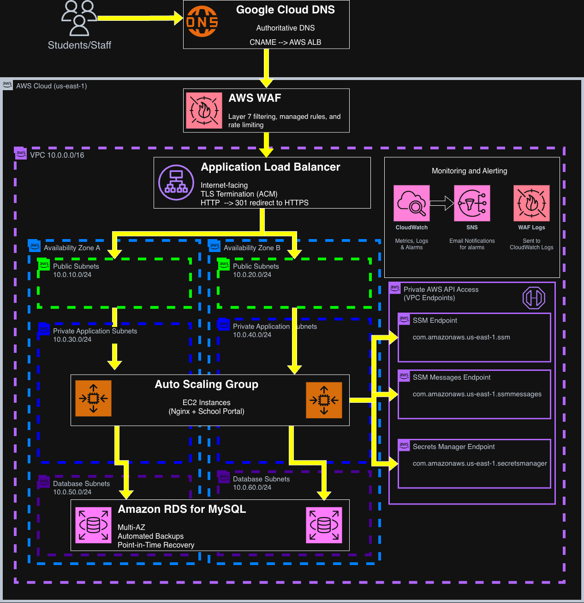

# Multi-Tier AWS School Portal: High Availability, Zero-NAT Security & Automated Recovery

Modernization of a legacy single-server LAMP school portal (serving ~8,000 students) into an isolated, multi-AZ AWS architecture provisioned via Terraform and Packer. Designed to handle predictable registration traffic spikes, eliminate single points of failure, enforce defense-in-depth without runtime internet egress, and establish a tested point-in-time recovery workflow.
## Executive Summary & Engineering Highlights
- **Workload & Ingress:** Internet-facing Application Load Balancer terminating TLS using an ACM-managed certificate, (`portal.lewsclassdomain.com`), fronted by Google Cloud DNS (external CNAME provider decoupling) and AWS WAF (rate limiting + AWS Common Rule Set).
- **Compute & Scaling:** EC2 instances in private subnets running across 2 Availability Zones within an Auto Scaling Group. Dynamic scaling via Target Tracking (`RequestCountPerTarget` @ 1,000) supplemented by Scheduled Scaling for registration windows.
- **Storage & Recovery:** Amazon RDS for MySQL deployed across Multi-AZ in isolated subnets. Point-in-time recovery validated to a 3m 24s data loss gap against an RPO target of 15 minutes.
- **Network Isolation (Zero-NAT Egress):** No NAT Gateways or public IPs on compute instances. Private communication to AWS APIs (ssm, ssmmessages, secretsmanager) routed strictly through Interface VPC Endpoints (AWS PrivateLink).
- **Immutable Infrastructure:** EC2 user-data bootstrapping replaced with Packer-baked Golden AMIs. Fleet rollouts handled through ASG Instance Refresh with `min_healthy_percentage = 100`.
- **Configuration Decoupling:** AWS Systems Manager Parameter Store supplies the database network endpoint; AWS Secrets Manager manages the database credentials.
## Architectural Breakdown & Request Flow 



```
                                    Clients (Internet)
                                          │
                                          │ [HTTPS :443]
                                          ▼
                                   Google Cloud DNS
                                          │
                                          │ [CNAME Resolution]
                                          ▼
                                       AWS WAF
                                (Managed Rules + Rate Limiting)
                                          │
                                          ▼
                             Application Load Balancer
                       [Public Subnets: 10.0.10.0/24, 10.0.20.0/24]
                                          │
                                          │ [HTTP :80 (VPC Internal)]
                                          ▼
                   ┌──────────────────────────────────────────────┐
                   │           Auto Scaling Group (EC2)           │
                   │ [Private App: 10.0.30.0/24, 10.0.40.0/24]    │
                   │   Packer Golden AMI (Ubuntu 22.04 + Nginx)   │
                   └───────┬──────────────────────────────┬───────┘
                           │                              │
         [HTTPS :443]      │                              │ [MySQL :3306]
     (Privatelink Endpoints)│                              │
                           ▼                              ▼
             Interface VPC Endpoints             Amazon RDS for MySQL
           • SSM / SSM Messages                 • Multi-AZ Failover
           • Secrets Manager                    • Private DB Subnets
                                                  (10.0.50.0/24, 10.0.60.0/24)
```

### 1. Ingress & Edge Protection
Public DNS requests resolve through Google Cloud DNS, directing traffic to the ALB via CNAME. Before reaching the load balancer listeners, Layer 7 requests pass through AWS WAF to inspect for cross-site scripting (XSS), SQL injection, and high-frequency rate-limiting violations. ALB terminates TLS using a wildcard/domain ACM certificate and redirects plain HTTP requests on port 80 to HTTPS port 443 with a `301 Moved Permanently`.
### 2. Private Compute & Auto Scaling
The ALB evaluates target health via GET /health on TCP port 80. The /health route is decoupled from the backend database to prevent cascading health-check failures during database maintenance. The Auto Scaling Group targets a steady-state fleet size of 2 instances distributed across two availability zones, bursting up to 6 instances based on either target tracking or scheduled cron events for known school calendar dates.
### 3. Least-Privilege Network & IAM Model
Workloads communicate through strict security group chaining rather than CIDR blocks:
- **ALB SG:** Accepts `:80` and `:443` from `0.0.0.0/0`. Egress allowed to EC2 SG on `:80`.
- **EC2 SG:** Ingress allowed exclusively from ALB SG on `:80`. Egress strictly locked to VPC Endpoint SG on `:443` and RDS SG on `:3306`. Unrestricted `0.0.0.0/0` outbound routing is omitted entirely.
- **RDS SG:** Ingress allowed exclusively from EC2 SG on `:3306`.
- **IAM Instance Profile:** Allows read-only access to `/school-portal/database/endpoint` in Parameter Store and `secretsmanager:GetSecretValue` against the specific database credentials secret ARN.

## Tradeoffs & Core Engineering Decisions
### 1. Dimension: OS Provisioning
- **Selected Approach:** Packer Golden AMI + ASG Instance Refresh
- **Alternative Considered:** User-data bootstrap scripts on base AMI
- **Technical Justification:** Eliminates runtime failures caused by external apt repository latency, upstream network timeouts, and variable startup times during auto-scaling events.

### 2. Dimension: Runtime Egress
- **Selected Approach:** Interface VPC Endpoints (PrivateLink)
- **Alternative Considered:** Managed NAT Gateways
- **Technical Justification:** Prevents instances from possessing an outbound path to the public internet, limiting malware exfiltration paths while fulfilling AWS API communication needs.

### 3. Dimension: Relational Database
- **Selected Approach:** Standard Amazon RDS for MySQL
- **Alternative Considered:** Amazon Aurora MySQL
- **Technical Justification:** Workload profile (~8,000 students, read/write patterns centered on scheduled windows) did not require Aurora-specific scaling or performance capabilities. Standard RDS Multi-AZ satisfied the project's availability, backup, recovery, and cost requirements. The PITR exercise met the 15-minute RPO target; the 60-minute RTO remained a design objective and was not formally measured.

### 4. Dimension: Secret Ingestion
- **Selected Approach:** Parameter Store + Secrets Manager
- **Alternative Considered:** Environment variables hardcoded in Terraform
- **Techincal Justification:** Separates endpoint discovery (where the service lives) from authentication (how to log in). Prevents sensitive database credentials from being stored in plaintext in version control or Terraform state files.

### 5. Dimension: DNS Provider
- **Selected Approach:** Google Cloud DNS
- **Alternative Considered:** AWS Route 53
- **Technical Justification:** Implements cross-provider separation of concerns: authoritative DNS delegation remains separate from the cloud compute provider hosting the workload.

## Verification & Resilience Testing

- The architecture was validated via intentional failure injection, traffic generation, and data recovery drills:

### Test Objective: Instance Self-Healing
- **Methodology:** Manually terminated an active EC2 instance via AWS CLI.
- **Observed Result:** ASG detected the capacity loss and launched a replacement instance, eventually restoring the two-instance fleet.
- **Operational Finding:** Healthy remaining targets continued serving application traffic during replacement.

### Test Objective: Application Process Fault
- **Methodology:** Stopped `nginx` systemd process on instance A via SSM Session Manager.
- **Observed Result:** `/health` check returned `502`/timeout; ALB stopped routing traffic to target A; ASG ELB health-check logic terminated and replaced target A.
- **Operational Finding:** Verified that ALB process monitoring catches dead web servers that still pass EC2 hypervisor checks.

### Test Objective: Horizontal Auto-Scaling
- **Methodology:** Injected ~2,500 requests across 2 targets using synthetic traffic generation.
- **Observed Result:** Traffic exceeded the 1,000 req/target target-tracking policy (~1,250 req/target); ASG scaled out from 2 to 3 instances; average target load settled to ~833 req/target.
- **Operational Finding:** Capacity scales based on measured application demand rather than CPU utilization alone.

### Test Objective: Zero-Downtime Rollout
- **Methodology:** Built updated Packer AMI; updated Launch Template; executed ASG Instance Refresh.
- **Observed Result:** ASG brought up new instances, awaited target group /health HTTP 200, then replaced the legacy instances. Continuous application requests returned HTTP 200 throughout the observed rollout.
- **Operational Finding:** Demonstrated an immutable rolling deployment with no observed application downtime.

### Test Objective: No-NAT Egress Isolation
- **Methodology:** Stripped default 0.0.0.0/0 route in private subnets; attempted `curl [https://amazon.com](https://amazon.com)`.
- **Observed Result:** Public internet connectivity failed as expected. Simultaneously, SSM Session Manager and Secrets Manager API calls functioned normally over Interface Endpoints.
- **Operational Finding:** Validated complete runtime isolation from the public internet.

### Test Objective: WAF Layer 7 Mitigation
- **Methodology:** Sent HTTP requests containing script injection strings (`<script>alert(1)</script>`) and rapid HTTP bursts.
- **Observed Result:** Injections returned HTTP `403 Forbidden` via AWS Common Rule Set; traffic bursts exceeding rate threshold were dropped before requests reached the application targets.
- **Operational Finding:** Layer 7 malicious payloads are halted before reaching the EC2 application targets.

### Test Objective: Point-in-Time Recovery
- **Methodology:** Simulated table deletion at `00:27:24 UTC`; initiated RDS PITR targeting `00:24:00 UTC`.
- **Observed Result:** Restored functional database instance within an actual data recovery point delta of 3m 24s (satisfying the 15-minute RPO target).
- **Operational Finding:** Parameter Store endpoint was updated to point to the newly restored RDS instance.

## Production Troubleshooting & Root Cause Analysis

### 1. Silent Bootstrap Failure Causing ALB 502 Bad Gateway
**Symptom:** Initial deployment passed `terraform apply` successfully, but the ALB returned `502 Bad Gateway`. Both backend targets showed as `Unhealthy` in the Target Group.  
**Investigation:** Connected to the private EC2 instance using AWS SSM Session Manager. Observed that `systemctl status nginx` returned `Unit nginx.service could not be found`. Inspected cloud-init output at `/var/log/cloud-init-output.log` and discovered a syntax error: an accidental leading whitespace prior to `#!/bin/bash` prevented execution of the user-data script.  
**Root Cause & Architectural Shift:** User-data execution failed silently without halting instance creation. Rather than simply fixing the bash script syntax, the deployment strategy was migrated to **Packer Golden AMIs**. Dependencies and configurations are now validated during the build phase before an AMI ID is emitted, significantly reducing runtime provisioning dependencies and eliminating the bootstrap failure mode encountered during the initial deployment.  

### 2. Stale Database Endpoint Caused by Configuration Drift 
**Symptom:** Following an RDS Point-in-Time Recovery test, the web application could not establish database connections, despite the network controls appearing correctly configured.  
**Investigation:** Checked the EC2 instance environment configuration and SSM Parameter Store. Found that while the new RDS instance was active, `/school-portal/database/endpoint` still resolved to the older, deleted RDS instance endpoint.  
**Root Cause:** The Terraform code allowed the database hostname parameter to be overridden via an input variable rather than dynamically binding to the resource output. This created two divergent sources of truth.  
**Resolution:** Modified the Terraform definition to directly export the dynamic RDS address:
```
resource "aws_ssm_parameter" "db_endpoint" {
  name  = "/school-portal/database/endpoint"
  type  = "String"
  value = aws_db_instance.portal_db.address
}
```
This guarantees that Terraform-managed infrastructure updates write directly to the single source of truth consumed by application instances.  
### 3. Broken ACM Validation Chain from Stale DNS Delegation  
**Symptom:** The AWS Certificate Manager (ACM) certificate for `portal.lewsclassdomain.com` remained indefinitely in `PENDING_VALIDATION`, preventing ALB HTTPS listener binding.  
**Investigation:** Queried the validation CNAME records using `dig +trace _x2.portal.lewsclassdomain.com CNAME`. Queries resulted in `SERVFAIL`. Tracing nameservers from the root servers revealed that the domain registrar was delegating to a deprecated Google Cloud DNS zone (`ns-cloud-b*.googledomains.com`), whereas the active managed zone was assigned to `ns-cloud-e*.googledomains.com`.  
**Root Cause:** A mismatch between the parent registrar's NS delegation records and the active Cloud DNS zone caused external DNS resolvers (including AWS validation probes) to hit an unauthoritative zone.  
**Resolution:** Updated the NS records at the registrar level to point to the active nameserver pool. ACM domain control validated successfully within 5 minutes of DNS propagation, and status transitioned to `ISSUED`.

### Infrastructure Lifecycle

Build & Deployment Sequence
1. Machine Image Creation:
```
Bash
packer init packer/portal-ami.pkr.hcl
packer build packer/portal-ami.pkr.hcl
```
2. Infrastructure Provisioning:
```
Bash
terraform -chdir=terraform init
terraform -chdir=terraform plan -out=tfplan
terraform -chdir=terraform apply tfplan
```
3. Environment Destruction:
```
Bash
terraform -chdir=terraform destroy -auto-approve
```

- Terraform successfully destroyed all 67 resources under Terraform management. Resources created outside of Terraform, including Packer-generated AMIs and associated snapshots, were identified and removed seperately, reinforcing the importance of defining ownership and lifecycle management for resources created by different tooling.

## Engineering Outcomes

**This project reinforced several principles:**
- Successful infrastructure provisioning does not guarantee application readiness.
- High availability and disaster recovery solve different problems.
- Runtime dependencies should be minimized and explicitly validated.
- Configuration indirection requires a clearly defined source of truth.
- Least privilege applies to network paths as well as IAM permissions.
- Failure injection and recovery testing provide stronger evidence than configuration alone.
- Additional cloud services should be introduced only when they solve an identified requirement.